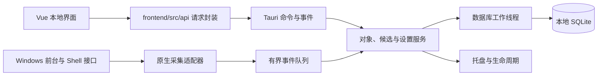

# 概要设计说明书

版本：`0.6.0`。日期：2026-10-11。状态：前后端已按职责拆分并联通，原生采集实机矩阵与发布验收待完成。

## 1. 系统边界

DeskTrace 在当前用户会话内运行一个 Tauri 进程。前端负责展示，Rust 后端负责采集、校验、业务判断和存储。没有远程服务、账户系统和本地 HTTP 后端。



## 2. 模块职责

| 模块 | 职责 | 边界 |
| --- | --- | --- |
| `desktrace-core` | 对象、事件、时间与候选规则 | 不依赖 Tauri，不直接访问系统 |
| `desktrace-windows` | 前台、Shell、应用清单和身份解析 | 不直接写数据库，不自行决定候选 |
| `desktrace-storage` | SQL、迁移、事务、查询与备份 | 单数据库写入入口 |
| Tauri 应用层 | 命令校验、任务调度、托盘与状态 | 薄封装，不堆叠采集实现 |
| 前端页面与组件 | 列表、详情、筛选和设置 | 系统访问统一通过 `frontend/src/api/` |

使用 Cargo workspace。独立核心库让候选和时间规则可在无 Windows 环境下测试；系统适配器仍需要 Windows 实机验证。

## 3. 运行方式

首次启动只完成引导和清单读取，用户启用后记录使用。关闭主窗口时隐藏至托盘；首次操作明确说明仍在记录。托盘提供打开、暂停/恢复与退出。开机启动默认关闭，由用户主动开启。

明确退出停止记录。锁屏与休眠期间暂停活跃刷新；恢复时重新解析当前对象。异常退出后的未验证时间段记为缺口，不补造历史。

限制每个用户只运行一个实例。后启动实例唤起现有窗口，避免重复采集和数据库多写入。

## 4. 页面和路由

| 路由 | 页面 | 主要内容 |
| --- | --- | --- |
| `/` | 概览 | 采集状态、观察时长、候选数量和缺口 |
| `/folders` | 文件夹列表 | 路径、最近浏览、候选与覆盖 |
| `/applications` | 应用列表 | 最近使用、安装/更新日期与来源 |
| `/objects/:id` | 对象详情 | 身份、时间依据、记录区间、排除 |
| `/settings` | 设置 | 范围、阈值、保留、开机启动和数据操作 |

页面必须注册路由。Pinia 保存采集状态和任务进度；分页、当前筛选和表单临时状态优先放在页面内部。详情不展示无必要的原始注册表数据。

## 5. 目录规划

前后端分别存放，下面列出初始化已建立的主要目录。后续的系统采集、生命周期和 E2E 目录在开发对应功能时新增。

```text
DeskTrace/
  README.md
  docs/                         # 中文命名的开发文档
  UI/                           # 独立静态原型，按用户要求保留原位置
  frontend/
    src/
      api/                      # IPC 请求与错误转换，含测试
      assets/
      components/
      pages/
      router/
      stores/                   # 状态管理，含测试
      types/
    package.json
    pnpm-lock.yaml
    pnpm-workspace.yaml
    index.html
    vite.config.ts
    tsconfig.json
    eslint.config.js
  backend/
    src-tauri/
      src/
        commands/
        services/
        lib.rs
        main.rs
      capabilities/
      icons/
      tauri.conf.json
      Cargo.toml
    crates/
      desktrace-core/            # 规则与类型，含 tests/
      desktrace-windows/         # 系统适配入口
      desktrace-storage/         # 数据访问，含 tests/
    migrations/                 # 新增迁移，旧文件不可修改
    Cargo.toml                  # Rust workspace
    Cargo.lock
    rust-toolchain.toml
```

`backend/Cargo.toml` 管理四个 workspace 成员，Rust 锁文件位于 `backend/`；前端清单和锁文件位于 `frontend/`。前端的 `tauri` 脚本切换至 `backend/src-tauri/` 执行 CLI，Tauri 配置通过 `../../frontend` 定位开发命令与构建资产。迁移随 Rust 存储库嵌入二进制，无需运行时从工作目录查找 SQL。

初始化桌面命令只有 `get_bootstrap_status`；Windows crate 当前只报告平台及未实现状态。

`UI/` 不参与 Vite 或 Rust 构建，按用户要求保留原位置。`0.6.0` 前端在 `frontend/src/` 中复用其设计并调用真实 IPC；样本位于测试夹具中，浏览器未连接桌面程序时保持空清单。数据来源与刷新机制见 [前端实现说明](前端实现说明.md)。

## 6. 数据流

应用清单读取形成对象和身份线索。日期单独进入证据表。前台与文件夹事件经过范围检查、身份匹配和去重，数据库事务同时写事件与最新时间。

列表查询读取对象聚合和区间覆盖，计算候选状态。候选不存成长期固定字段，避免阈值改变或时间推进后失真。前端只展示后端结果，不能自行把空日期判断为未使用。

数据库放在当前用户本地应用数据目录。默认原始使用事件保留 180 天；最近直接使用聚合、首次发现、必要日期证据和压缩后的采集区间保留至用户清除。保留策略不隐式重置观察起点。

## 7. 故障与降级

应用清单、应用使用与文件夹采集分别报告健康状态。某模块失败不会清空其他模块数据。未支持的标签页不产生文件夹事件；权限失败显示可观察范围减少。

写入失败立即停止相关证据刷新并显示状态；队列溢出、COM 失效和时间异常留下缺口。恢复成功后重新开始有效区间，不能把故障期算作连续记录。

## 8. 架构约定

核心库公共 API 写中文文档注释，使用 `Result` 和明确错误类型；不以 `unwrap()`、`expect()` 或 `panic!` 处理可恢复错误。FFI 所需 `unsafe` 限定在 Windows 适配器内，并解释生命周期和句柄安全前提。

TypeScript 开启 `strict: true`，公共类型位于 `frontend/src/types/`。接口参数和返回值有类型，异常用 `unknown` 收窄。前端 2 空格，Rust 4 空格，注释解释原因。

维护备注：`maorongkang@gmail.com`。
